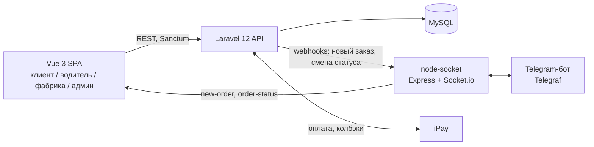

# Aqua Taxi

Платформа заказа и доставки воды: клиенты оставляют заказы, водители принимают их (в вебе или через Telegram-бота), фабрики-производители проходят модерацию и тоже принимают заказы. Заказы в реальном времени, карта с геолокацией, оплата пополнения баланса через iPay.

Проект разработан по заказу целиком мной: бэкенд, веб-клиент, сервис уведомлений и Telegram-бот, Docker. Функционал реализован, проект сейчас на паузе.

## Возможности

**Клиент**
* Регистрация и вход, создание заказа воды, список активных заказов, завершение и отмена заказа.

**Водитель**
* Регистрация и вход (с ограничением частоты попыток), профиль, баланс.
* Пополнение баланса через iPay: инициация платежа, колбэк провайдера, проверка статуса.
* Новые, активные и отменённые заказы, принятие и отмена заказа, передача геопозиции.
* Привязка Telegram-аккаунта по одноразовому коду; принятие или отклонение заказа кнопками в боте.

**Фабрика**
* Регистрация и вход, загрузка сертификата, баланс и оплата через iPay.
* Заказы для фабрик: водители создают заявки, фабрика принимает и завершает их.

**Администратор**
* Модерация фабрик: одобрить, отклонить, проверить сертификат, снять верификацию, удалить сертификат.

**Публично**
* Список проверенных фабрик и их координаты для карты (Leaflet).

## Архитектура



* **Laravel** — основное API: заказы, пользователи четырёх ролей, баланс и платежи, модерация; Sanctum, Reverb, throttle на входе.
* **node-socket** — отдельный сервис на Node.js: принимает от Laravel защищённые токеном вебхуки (`/webhooks/new-order`, `/webhooks/order-status`), рассылает события клиентам по Socket.io и ведёт Telegram-бота (`/start`, `/attach`, кнопки принятия и отклонения заказа). Подробности — в `node-socket/README.md`.
* **Фронтенд** — Vue 3, Vue Router, Pinia, Tailwind CSS 4, Leaflet, pdf.js для просмотра сертификатов, Laravel Echo.

## Стек

| Часть | Технологии |
|---|---|
| Backend | PHP 8.2, Laravel 12, Sanctum, Reverb, MySQL |
| Frontend | Vue 3, Vite 6, Pinia, Vue Router, Tailwind CSS 4, Leaflet, Laravel Echo |
| node-socket | Node.js, Express, Socket.io, Telegraf, Jest, Supertest |
| Платежи | iPay (песочница и продакшен) |
| Инфраструктура | Docker Compose (PHP-FPM, Nginx, MySQL), GitHub Actions для тестов |

## Структура репозитория

```
├── app/             # контроллеры, модели (User, Driver, Factory, Order, FactoryOrder, платежи)
├── routes/          # api.php, web.php, channels.php
├── database/        # миграции, сидеры
├── resources/js/    # Vue-клиент (views, router, store, components)
├── node-socket/     # сервис Socket.io и Telegram-бот
├── docker/          # конфигурации Nginx
├── tests/           # PHPUnit
├── docker-compose.yml          # конфигурация для сервера
└── docker-compose.local.yml    # локальная разработка
```

## Запуск локально

1. Скопируйте файлы окружения:
   ```bash
   cp .env.example .env
   cp node-socket/.env.example node-socket/.env
   ```
   В `.env` укажите доступ к MySQL из `docker-compose.local.yml` (`DB_CONNECTION=mysql`, `DB_HOST=mysql`, `DB_DATABASE=aqua`, `DB_USERNAME=aqua`, `DB_PASSWORD=aqua`), `NODE_SOCKET_TOKEN` (такой же в `node-socket/.env`) и ключи Reverb. Для платежей нужны тестовые данные iPay.

2. Поднимите приложение (контейнер сам установит зависимости, сгенерирует ключ и применит миграции):
   ```bash
   docker-compose -f docker-compose.local.yml up --build
   ```
   Приложение будет доступно на http://localhost:8080.

3. Запустите сервис уведомлений и бота:
   ```bash
   cd node-socket
   npm install
   npm start
   ```
   Проверка: `GET /health`, Socket.io-клиенты подключаются к порту `3000`.

Пароли БД в `docker-compose*.yml` — заглушки для разработки. Для сервера используйте свои значения и храните их только в окружении.

## Тесты

* Laravel (PHPUnit): `php artisan test`; в CI тесты запускаются на PHP 8.2, 8.3 и 8.4.
* node-socket (Jest + Supertest): `cd node-socket && npm test`.
* Результаты прогона и известные проблемы — в `TESTING_REPORT.md`.
